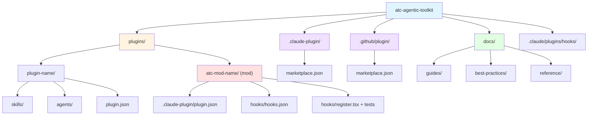

# ATC Agentic Toolkit


**Standardize and accelerate AI-assisted development across teams**

A curated collection of prompts, skills, plugins, and best practices for AI coding agents. The ATC Agentic Toolkit provides production-ready configurations and reusable components for Claude Code and GitHub Copilot, with a focus on .NET development and enterprise patterns.

---

## 📑 Table of Contents

- [ATC Agentic Toolkit](#atc-agentic-toolkit)
  - [📑 Table of Contents](#-table-of-contents)
  - [💡 What is ATC Agentic Toolkit?](#-what-is-atc-agentic-toolkit)
  - [🚀 Quick Start](#-quick-start)
  - [🔌 Available Plugins](#-available-plugins)
    - [Skill plugins](#skill-plugins)
    - [Hooks](#hooks)
    - [Mods](#mods)
  - [🧩 Mods](#-mods)
  - [📁 Project Structure](#-project-structure)
  - [🛠️ Plugin Development](#️-plugin-development)
  - [✅ Requirements](#-requirements)
  - [📚 Documentation](#-documentation)
    - [📘 Guides](#-guides)
    - [✨ Best Practices](#-best-practices)
    - [📖 Reference](#-reference)
  - [🔧 Troubleshooting](#-troubleshooting)
  - [🤝 How to contribute](#-how-to-contribute)

---

## 💡 What is ATC Agentic Toolkit?

AI coding assistants like Claude Code and GitHub Copilot are transforming software development, but without standardized configurations, teams face:

- **Inconsistent agent behavior** across projects and developers
- **Repeated context setup** for common tasks
- **Lost productivity gains** from reinventing prompts and workflows
- **Knowledge silos** where effective patterns aren't shared

ATC Agentic Toolkit solves this by providing:

- **Reusable Components** - Skills and plugins that work out of the box
- **Team Consistency** - Standardized configurations that ensure predictable AI behavior
- **Enterprise-Ready** - Production patterns for .NET, Azure, and enterprise development
- **Extensible Framework** - Custom marketplace system for distributing internal tooling

---

## 🚀 Quick Start

### 🖥️ Copilot CLI / Claude Code

1. Launch Copilot CLI or Claude Code
2. Add the marketplace:
   ```
   /plugin marketplace add atc-net/atc-agentic-toolkit
   ```
3. Install a plugin:
   ```
   /plugin install <plugin>@atc-agentic-toolkit
   ```
4. Restart to load the new plugins
5. View available skills:
   ```
   /skills
   ```
6. View available agents:
   ```
   /agents
   ```
7. Update plugin (on demand):
   ```
   /plugin update <plugin>@atc-agentic-toolkit
   ```

### 🆚 VS Code

Turn on agent plugins and add the marketplace in your `settings.json`:

```jsonc
// settings.json
{
  "chat.plugins.enabled": true,
  "chat.plugins.marketplaces": ["atc-net/atc-agentic-toolkit"]
}
```

Then browse and install the plugins in one of these ways:

- In the Extensions view, search for `@agentPlugins`.
- Run **Chat: Open Customizations** from the Command Palette and open **Plugins**.

The first install from the marketplace asks you to trust it. `chat.plugins.marketplaces` is still marked experimental, and your organization may limit which plugins and marketplaces you can use. See [Agent plugins in VS Code](https://code.visualstudio.com/docs/agent-customization/agent-plugins).

---

## 🔌 Available Plugins

Everything below is a plugin, installed from the same marketplace. They come in three kinds.

### Skill plugins

Skills, agents and MCP servers. They work in Claude Code and GitHub Copilot.

| Plugin | Description |
|--------|-------------|
| [aspire](plugins/aspire/) | Aspire distributed application orchestration skills |
| [atc](plugins/atc/) | ATC.NET library skills including REST API source generation from OpenAPI specs, WPF controls, and cross-platform XAML development |
| [azure](plugins/azure/) | Azure services skills covering 200+ cloud services, IoT, AI, data, networking, and more |
| [bicep](plugins/bicep/) | Azure Bicep IaC best practices, naming conventions, modularization, and security patterns |
| [common](plugins/common/) | Common base skills including documentation generators, implementation planning, and utility tools |
| [cosmosdb](plugins/cosmosdb/) | Azure Cosmos DB data modeling workflow and best-practice rules for partitioning, queries, SDK usage, indexing, and more |
| [dataverse](plugins/dataverse/) | Microsoft Dataverse and Power Platform skills covering connection setup, data, queries, schema, solutions, administration, and security |
| [docker](plugins/docker/) | Docker and containerization best practices covering Dockerfile optimization, multi-stage builds, security, and orchestration |
| [dotnet](plugins/dotnet/) | C#/.NET development skills including refactoring, testing, async patterns, and NuGet management |
| [git](plugins/git/) | Git workflow utilities including commit message generators and PR descriptions |
| [github](plugins/github/) | GitHub platform skills including CI/CD workflow conventions for GitHub Actions and GitHub issue management |
| [playwright](plugins/playwright/) | Browser automation and testing skills using Playwright |
| [powershell](plugins/powershell/) | PowerShell cmdlet development and scripting best practices based on Microsoft guidelines |
| [security](plugins/security/) | Security best practices and OWASP Top 10 guidelines for secure coding across all languages and frameworks |
| [web](plugins/web/) | Web development skills covering HTML, CSS, JavaScript, web APIs, security, performance, and accessibility |

### Hooks

Shell hooks that run on Claude Code events. Claude Code only.

| Plugin | Description |
|--------|-------------|
| [hooks](.claude/plugins/hooks/) | Automation hooks for Claude Code sessions: notifications and workflow enhancements |

### Mods

Mods change Claude Code itself while it runs: a bar above the prompt, a side pane, a check before a risky command. They need Claude Code 2.1.287 or newer. See [🧩 Mods](#-mods) for the list, with what each one shows, its commands and its settings.

---

## 🧩 Mods

Mods are plugins that change Claude Code itself while it runs. They can add a bar above the prompt, a side pane, slash commands, or react to tool calls, using Claude Code's function-hooks API (`hooks/hooks.json` → `hooks/register.tsx`).

> [!IMPORTANT]
> Mods require **Claude Code 2.1.287 or newer** (check with `claude --version`, update with `claude update`). They are Claude Code only: GitHub Copilot doesn't load them, so they're listed only in the Claude marketplace. The old `CLAUDE_CODE_ENABLE_FUNCTION_HOOKS` flag is no longer needed and is ignored.

| Mod | What it shows | Commands | Settings |
|-----|---------------|----------|----------|
| [atc-blast-radius](plugins/atc-blast-radius/) | Before `rm -rf`, `Remove-Item -Recurse`, `git reset --hard`, `git clean`, a force push or a migration runs: what it would delete or throw away, then **Cancel** / **Proceed** | none (works on its own) | none |
| [atc-progress](plugins/atc-progress/) | A plan bar above the prompt (from `plan/*.md`) and a subagents pane with model, context, tokens, estimated cost and time | `/atc-progress [plans\|plan [path]\|continue [path]\|open\|close\|hide\|show\|help]` | `autoOpen`: `off` / `agents` |
| [atc-replay-theater](plugins/atc-replay-theater/) | After a turn that edited files, a hint above the prompt, then a pane that steps through each edit's diff with Prev / Next | `/atc-replay [close\|clear\|help]` | none |

### Install a mod

```text
/plugin marketplace add atc-net/atc-agentic-toolkit
/plugin install atc-progress@atc-agentic-toolkit
```

Or from a shell: `claude plugin install atc-progress@atc-agentic-toolkit`. A mod with only hooks runs straight after install. If it doesn't show up, run `/reload-plugins` or restart Claude Code.

### Activate / deactivate

| Action | In a session | From a shell |
|--------|--------------|--------------|
| Disable | `/plugin` → select the mod → Disable | `claude plugin disable atc-progress@atc-agentic-toolkit` |
| Enable | `/plugin` → select the mod → Enable | `claude plugin enable atc-progress@atc-agentic-toolkit` |
| Uninstall | `/plugin` → select the mod → Uninstall | `claude plugin uninstall atc-progress@atc-agentic-toolkit` |
| See what's installed | `/plugin` | `claude plugin list` |

Run `/reload-plugins` (or restart) after enabling or disabling.

### Mod settings

Installing a mod asks for its options. Change them later in `/config`, where each option is a row under the mod's name. Each mod's README lists its options and has a **Try it** section with prompts to test it.

---

## 📁 Project Structure



**Key Directories:**

- `plugins/` - Plugin implementations (skills, agents, configs)
- `plugins/atc-*/` - Claude Code mods (TypeScript function hooks; Claude Code 2.1.287 or newer)
- `.claude/plugins/hooks/` - Claude Code specific hooks
- `.claude-plugin/` - Claude Code marketplace configuration (skill plugins and mods)
- `.github/plugin/` - GitHub Copilot marketplace configuration (skill plugins only)
- `docs/` - Comprehensive documentation (guides, best practices, reference)

---

## 🛠️ Plugin Development

Want to create your own plugins? The toolkit provides a complete framework for developing, testing, and distributing custom plugins.

1. **Use the skill-creator skill** to generate plugin structure
2. **Define your plugin** in `plugin.json` at the plugin root
3. **Create skills** in `plugins/[your-plugin]/skills/`
4. **Test locally** in your project
5. **Register** in both `.claude-plugin/marketplace.json` and `.github/plugin/marketplace.json`. A mod goes only in `.claude-plugin/marketplace.json`.

**Documentation:**

- [Plugin Development Guide](docs/guides/plugin-development.md)
- [Skill Creation Guide](docs/guides/skill-creation.md)
- [Plugin Structure Reference](docs/reference/plugin-structure.md)

### Working on a mod locally

Point `--plugin-dir` at the mod's folder in your clone to run it for one session without installing it. Use an absolute path so it works from any project, and repeat the flag to load several mods. Saving a file in the folder reloads the mod.

```bash
claude --plugin-dir <path-to-clone>/plugins/atc-progress
```

To load it in every session (the desktop app included), add the path to `CLAUDE_CODE_PLUGIN_DIRS` in the `env` block of `~/.claude/settings.json`. Separate several folders with `;` on Windows and `:` on macOS/Linux. Options for a mod loaded this way go under `pluginConfigs`:

```json
{
  "env": { "CLAUDE_CODE_PLUGIN_DIRS": "E:/Dev/atc-agentic-toolkit/plugins/atc-progress" },
  "pluginConfigs": { "atc-progress": { "options": { "autoOpen": "agents" } } }
}
```

Check a mod with `claude plugin validate plugins/<mod>` and `claude plugin test plugins/<mod>`.

---

## ✅ Requirements

- **.NET SDK** (9.0 or higher) - [Download](https://dotnet.microsoft.com/download)
- **Python 3.x** - [Download](https://www.python.org/downloads/)
- **GitHub Copilot** (CLI or VS Code extension) - or -
- **Claude Code CLI** - [Installation Guide](https://code.claude.com/docs/en/overview). The one-step `/plugin install <plugin> --marketplace …` needs 2.1.275 or newer, and mods need 2.1.287 or newer.
- **Git** - [Download](https://git-scm.com/downloads)

```bash
dotnet --version    # Should show 9.0 or higher
python --version    # Should show 3.x
claude --version    # Should show 2.1.287 or newer for mods
git --version       # Should show Git version
```

---

## 📚 Documentation

### 📘 Guides

- [Plugin Development](docs/guides/plugin-development.md) - Creating plugins
- [Skill Creation](docs/guides/skill-creation.md) - Building skills
- [Agent Creation](docs/guides/agent-creation.md) - Building specialized agents

### ✨ Best Practices

- [Claude Code Fundamentals](docs/best-practices/claude-code-fundamentals.md) - Core concepts
- [Effective Prompts](docs/best-practices/effective-prompts.md) - Prompt engineering
- [Context Management](docs/best-practices/context-management.md) - Advanced techniques
- [Team Standards](docs/best-practices/team-standards.md) - ATC-Net conventions

### 📖 Reference

- [.claude/ Folder Structure](docs/reference/claude-folder-structure.md) - Every canonical file Claude Code reads
- [Plugin Structure](docs/reference/plugin-structure.md) - Directory layout
- [Skill Anatomy](docs/reference/skill-anatomy.md) - SKILL.md format
- [Marketplace Config](docs/reference/marketplace-config.md) - marketplace.json schema

---

## 🔧 Troubleshooting

**Plugin Not Found:** Verify the marketplace was added correctly, check that the plugin was installed, and restart Claude Code CLI.

**Installation Issues:** Ensure Claude Code CLI is up to date, check network connection, and verify the marketplace URL is correct.

---

## 🤝 How to contribute

[Contribution Guidelines](https://atc-net.github.io/introduction/about-atc#how-to-contribute)

[Coding Guidelines](https://atc-net.github.io/introduction/about-atc#coding-guidelines)
