# The `.claude/` Folder, Fully Mapped

Reference for the files and folders Claude Code reads: at the project root, inside `.claude/`, and at
the user level (`~/.claude/`). Use it to see where configuration lives, what each file does, and how
the pieces load.

> This is a generic Claude Code reference. For how *this toolkit* is laid out (a plugin marketplace),
> see [Plugin Structure](plugin-structure.md) and the Project Structure diagram in the
> [root README](../../README.md).

## Map

```mermaid
graph TD
    root["your-project/"]
    root --> cm["CLAUDE.md / AGENTS.md — project instructions, advisory"]
    root --> cml["CLAUDE.local.md — personal overrides, gitignored"]
    root --> mcp[".mcp.json — project MCP servers, root only"]
    root --> wti[".worktreeinclude — gitignored files to copy into worktrees"]
    root --> claude[".claude/ — project configuration"]

    claude --> settings["settings.json — shared settings, committed"]
    claude --> slocal["settings.local.json — personal settings, gitignored"]
    claude --> rules["rules/ — path-scoped instructions"]
    claude --> skills["skills/ — skills, also /name commands"]
    claude --> commands["commands/ — single-file commands, same mechanism as skills"]
    claude --> agents["agents/ — subagents, isolated context"]
    claude --> workflows["workflows/ — dynamic workflow scripts"]
    claude --> amem["agent-memory/ — subagent memory"]
    claude --> styles["output-styles/ — custom response styles"]
    claude --> hooksdir["hooks/ — convention only; registered in settings.json"]

    style root fill:#e1ffe1
    style claude fill:#e1f5ff
    style cm fill:#fff4e1
    style settings fill:#f0e1ff
    style hooksdir fill:#ffe1e1
```



> **Loading model in one line:** `CLAUDE.md`, `rules/` and auto memory are *advisory context*.
> `settings.json` is *configuration*. Hooks are *deterministic*: they fire on events, but only
> because a settings file or an enabled plugin registers them. Skills load *on demand*.

## Project root

| File | Purpose | Caveats |
|------|---------|---------|
| `CLAUDE.md` | Team-shared project instructions (architecture, conventions, commands), loaded at session start. Also valid at `.claude/CLAUDE.md`. | Advisory context, **not** enforced configuration. Keep it concise; long files reduce adherence. Supports `@path` imports (see below). |
| `AGENTS.md` | Instructions written for any coding agent. | Read when there's no `CLAUDE.md`, `.claude/CLAUDE.md` or `CLAUDE.local.md` in the working directory or above it. Needs Claude Code 2.1.277+. Change the behaviour with **Project instructions** in `/config`. This repository uses `AGENTS.md`. |
| `CLAUDE.local.md` | Personal, project-specific instructions. | Add to `.gitignore`. Exists only in the worktree where you created it. It also counts as a `CLAUDE.md`, so it stops `AGENTS.md` from loading by default. |
| `.mcp.json` | Project-scoped MCP servers, shared via git. | **Must be at the project root** (not under `.claude/`). Claude Code asks for approval before using each server. Supports `${VAR}` / `${VAR:-default}` expansion. |
| `.worktreeinclude` | Gitignored files to copy into new worktrees, such as `.env`. | Project only. |

### Memory imports (`@path`)

Inside `CLAUDE.md` (or `CLAUDE.local.md`) you can pull in other files inline:

```markdown
See @README.md for an overview and @docs/git-workflow.md for the branching model.
Personal cross-project rules: @~/.claude/my-rules.md
```

- Imports expand at launch.
- Relative paths resolve from the file that contains the import, not from the working directory.
- Imported files can import others, up to four hops deep.
- An `@path` inside backticks or a code block isn't imported.
- The first time a project imports a file outside the working directory, Claude Code asks you to
  approve it.

## `.claude/` directory

| Entry | Purpose | Caveats |
|-------|---------|---------|
| `settings.json` | Shared project settings: permissions, hooks, env vars, model, plugins. | **Committed to git.** Add `"$schema": "https://json.schemastore.org/claude-code-settings.json"` for editor validation. Claude Code reloads most edits in the running session; `model` and `effortLevel` are read only at start (use `/model` and `/effort` instead). |
| `settings.local.json` | Personal settings overrides for this project. | Higher precedence than `settings.json`. When Claude Code creates the file it adds it to your global git excludes; if you create it by hand, gitignore it yourself. |
| `rules/*.md` | Topic-scoped instructions. A file with no `paths` frontmatter loads every session; one with `paths: ["src/**/*.ts"]` loads when Claude works with matching files. | The scalable alternative to one huge `CLAUDE.md`. Also available at `~/.claude/rules/`. |
| `skills/<name>/SKILL.md` | Reusable skills. The folder name is the skill name; YAML frontmatter controls invocation. | Each skill is also a `/name` command. Claude loads it when relevant unless `disable-model-invocation: true`. |
| `commands/<name>.md` | Single-file commands (`/deploy` from `deploy.md`). | Still works. Commands and skills are the same mechanism; prefer `skills/` for new work, since a skill can bundle supporting files. |
| `agents/<name>.md` | Subagent definitions (system prompt plus tool and model settings), one per file. | Each runs in its **own context window** and returns a summary. Manage them with `/agents`. See [Agent Anatomy](agent-anatomy.md). |
| `workflows/*.js` | Dynamic workflow scripts that orchestrate many subagents. Each file becomes a `/<name>` command. | Saved from `/workflows`. |
| `agent-memory/<name>/` | Persistent memory for a subagent that sets the `memory` field. | Separate from your main session's auto memory. |
| `output-styles/<name>.md` | Change Claude's role, tone or response format through the system prompt. | Pick one in `/config` or with the `outputStyle` setting. |
| `hooks/` | A **convention** for storing hook scripts. | Not auto-discovered. Hooks run only when **registered** in a settings file or by an enabled plugin. The scripts can live anywhere. |

### How hooks actually work

There is no magic `hooks/` folder. A hook is a handler registered against an event in a settings file
(user, project, local or managed), in an enabled plugin's `hooks/hooks.json`, or in a skill's or
subagent's frontmatter:

```json
{
  "hooks": {
    "PostToolUse": [
      {
        "matcher": "Edit|Write",
        "hooks": [
          { "type": "command", "command": "${CLAUDE_PROJECT_DIR}/.claude/hooks/check-style.sh" }
        ]
      }
    ]
  }
}
```

**Handler types:**

| `type` | What runs |
|--------|-----------|
| `command` | A command that gets the event as JSON on stdin. With `args` it runs without a shell (exec form); without `args` it runs through a shell. `"shell": "powershell"` picks PowerShell |
| `http` | A POST of the event JSON to a URL |
| `mcp_tool` | A tool on a configured MCP server |
| `prompt` | A single-turn check by a Claude model |
| `agent` | A subagent that can use tools to check a condition (experimental) |

**Events:**

| Group | Events |
|-------|--------|
| Session | `SessionStart`, `Setup`, `SessionEnd`, `InstructionsLoaded`, `ConfigChange`, `CwdChanged`, `DirectoryAdded`, `FileChanged` |
| Prompt | `UserPromptSubmit`, `UserPromptExpansion`, `MessageDisplay`, `Notification` |
| Tools | `PreToolUse`, `PermissionRequest`, `PermissionDenied`, `PostToolUse`, `PostToolUseFailure`, `PostToolBatch` |
| Turn end | `Stop`, `StopFailure` |
| Subagents and tasks | `SubagentStart`, `SubagentStop`, `TaskCreated`, `TaskCompleted`, `TeammateIdle` |
| Context and model | `PreCompact`, `PostCompact`, `PreModelSwitch`, `PostModelSwitch` |
| Worktrees | `WorktreeCreate`, `WorktreeRemove` |
| MCP | `Elicitation`, `ElicitationResult` |

- Exit code `2` blocks the action on events that can block, with stderr as the reason. Other non-zero
  codes are non-blocking errors.
- `/hooks` shows every registered hook and where it came from.
- Hooks from all sources merge.

A plugin can also register hooks as TypeScript functions that run inside Claude Code. That kind of
plugin is a mod. See the [Mod Creation Guide](../guides/mod-creation.md).

### The status line is a setting, not a file

The bottom-bar status line is the `statusLine` object in `settings.json` (a command whose stdout is
rendered). There is no `.claude/statusline` file or folder:

```json
{
  "statusLine": { "type": "command", "command": "path/to/script.sh" }
}
```

## User level: `~/.claude/`

The same building blocks exist at the user level and apply to every project on the machine:

- `settings.json`: user-wide settings
- `CLAUDE.md`: user-wide instructions
- `rules/`, `skills/`, `commands/`, `agents/`, `workflows/`, `output-styles/`, `agent-memory/`:
  user-wide versions of the project folders

Files that exist only at the user level:

| Path | Purpose |
|------|---------|
| `~/.claude.json` | App state, sign-in, UI toggles and personal MCP servers. It sits next to `~/.claude/`, not inside it |
| `keybindings.json` | Custom keyboard shortcuts |
| `themes/*.json` | Custom color themes |
| `projects/<project>/memory/` | Auto memory (see below) |
| `projects/<project>/*.jsonl` | Session transcripts. Deleted after `cleanupPeriodDays` (default 30) |
| `plugins/` | Cloned marketplaces, installed plugin versions (`cache/`), per-plugin data (`data/`) and the `installed_plugins.json` record. Managed by `claude plugin` commands |

## Auto memory

Auto memory is notes Claude writes for itself: your preferences, corrections, and project facts it
can't get from the code.

- **Location:** `~/.claude/projects/<project>/memory/`. `<project>` comes from the git repository, so
  every worktree and subfolder of one repository shares the folder. It is local to your machine.
- **Files:** `MEMORY.md` is an index with one line per memory. Each memory is a topic file next to it,
  such as `feedback_testing.md`, with a `type` of `user`, `feedback`, `project` or `reference`.
- **Loading:** the first 200 lines or 25 KB of `MEMORY.md`, whichever comes first, load into every
  session. Topic files load only when Claude reads them.
- **Not in subagents:** the main session's auto memory isn't loaded into subagents, except forks.
- **On or off:** toggle it in `/memory`, which saves `autoMemoryEnabled` in `~/.claude/settings.json`.
  Set `"autoMemoryEnabled": false` in a project's settings to turn it off there, or set
  `CLAUDE_CODE_DISABLE_AUTO_MEMORY=1`.
- **Another folder:** set `autoMemoryDirectory` to an absolute path or one starting with `~/`.
- **Editing:** the files are plain Markdown. `/memory` lists them and opens the folder. The transcript
  cleanup doesn't delete them.

## Settings precedence

When the same key is set in more than one place, the higher level wins:

1. **Managed** (organization policy: `managed-settings.json`, MDM or the claude.ai console): highest
2. **Command line**: JSON passed with `--settings` for one session
3. **Local**: `.claude/settings.local.json`
4. **Project**: `.claude/settings.json`
5. **User**: `~/.claude/settings.json`: lowest

List settings, such as `permissions.allow`, **merge** across levels instead of overriding. Flags such as
`--model` aren't a level in this stack; each setting's reference entry says which flag overrides it.
Run `/status` to see which settings files loaded.

## Common misconceptions

- **`.claude/hooks/` is not auto-loaded.** Hooks fire only when a settings file or an enabled plugin
  registers them (see above).
- **`statusline` is not a file.** It is the `statusLine` object in `settings.json`.
- **Claude Code doesn't scan `.claude/plugins/`.** A plugin loads only when it's installed from a
  marketplace, loaded with `claude --plugin-dir ./my-plugin`, or saved as a plugin under
  `.claude/skills/`. This repository keeps its `hooks` plugin in `.claude/plugins/hooks/`, but it loads
  because `.claude-plugin/marketplace.json` lists that path, not because of the folder.
- **A plugin manifest lives at `.claude-plugin/plugin.json`.** It is optional: without one, Claude Code
  loads components from the standard layout. This repository's skill plugins keep a `plugin.json` at
  the plugin root for GitHub Copilot, and Claude Code ignores that file. Mods and the hooks plugin use
  `.claude-plugin/plugin.json`. See [Plugin Structure](plugin-structure.md#manifest-files).
- **`commands/` is not dead.** It still works, but commands and skills are the same mechanism. Prefer
  `skills/` for new work.
- **Auto memory is not `CLAUDE.md`.** You write `CLAUDE.md`; Claude writes auto memory. Both load at
  session start as context, not as enforced rules.

## Resources

- [Plugin Structure Reference](plugin-structure.md): how plugins in this repo are laid out
- [Skill Anatomy Reference](skill-anatomy.md): the `SKILL.md` format
- [Agent Anatomy Reference](agent-anatomy.md): the subagent file format
- [Claude Code Fundamentals](../best-practices/claude-code-fundamentals.md): core concepts and memory
- Official docs: [Explore the .claude directory](https://code.claude.com/docs/en/claude-directory) ·
  [Settings](https://code.claude.com/docs/en/settings) ·
  [Memory & rules](https://code.claude.com/docs/en/memory) ·
  [Hooks](https://code.claude.com/docs/en/hooks) ·
  [Skills](https://code.claude.com/docs/en/skills) ·
  [Subagents](https://code.claude.com/docs/en/sub-agents) ·
  [Output styles](https://code.claude.com/docs/en/output-styles) ·
  [Status line](https://code.claude.com/docs/en/statusline) ·
  [MCP](https://code.claude.com/docs/en/mcp)
